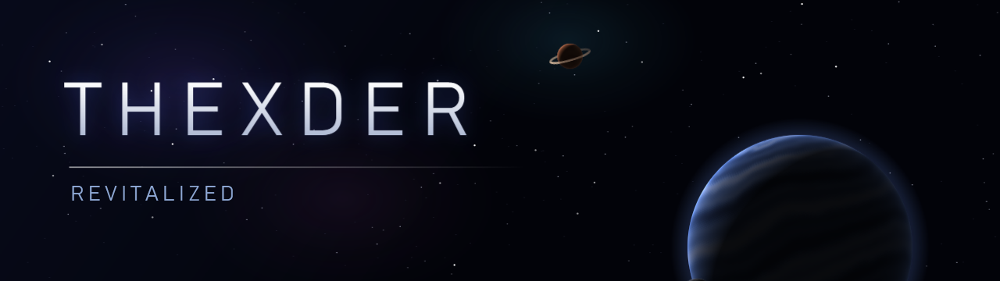
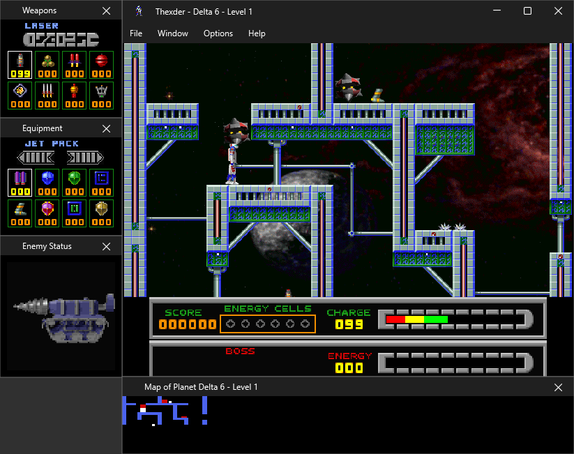
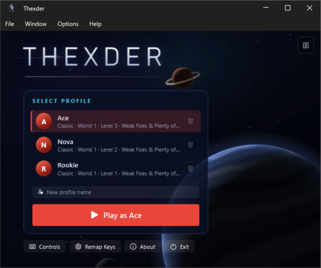
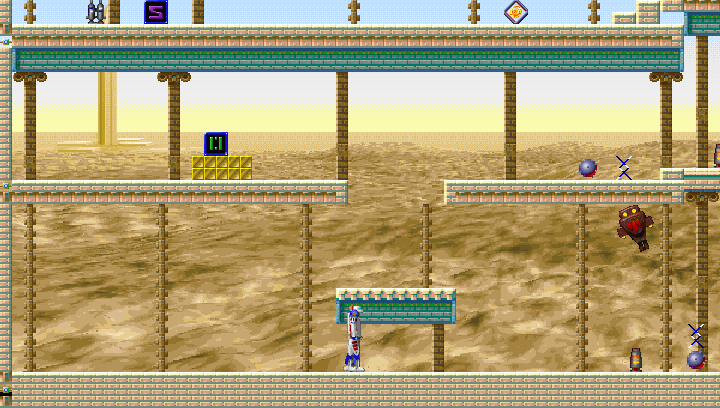
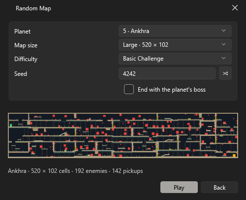
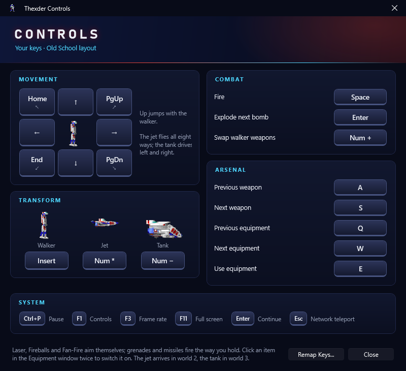
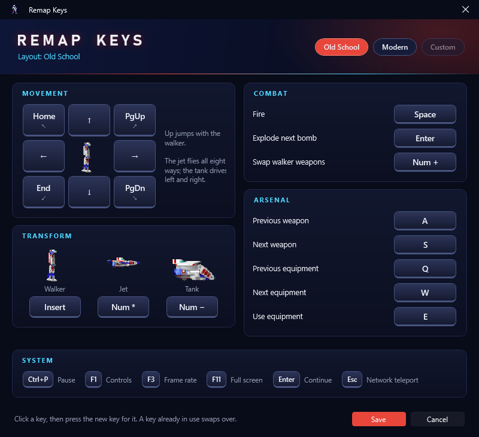

<p align="center">
  
</p>

<p align="center">
  
  
  
  <a href="LICENSE"></a>
  <a href="https://ko-fi.com/focsy"></a>
</p>

<p align="center">
  Sierra's <i>Thexder for Windows 95</i> (1995), re-implementation in C# to run on Windows 10 and 11.<br>
  You bring your own game CD; this program does the rest.
</p>

<p align="center">
  <a href="#the-revitalization-project">Revitalization Project</a> ·
  <a href="#the-game">The Game</a> ·
  <a href="#why-this-exists">Why This Exists</a> ·
  <a href="#whats-new">What's New</a> ·
  <a href="#roadmap">Roadmap</a> ·
  <a href="#getting-started">Getting Started</a> ·
  <a href="#controls">Controls</a> ·
  <a href="#building-from-source">Building</a> ·
  <a href="#ideas-bugs-and-questions">Feedback</a> ·
  <a href="#credits">Credits</a> ·
  <a href="#license">License</a>
</p>

---

## The Revitalization Project

Plenty of games from the 1990s still exist on the discs people bought, but the programs on those discs stop working
as Windows moves on. They lean on components that are gone, on display modes nobody uses, or on bugs that an older
system happened to tolerate. The disc is fine; the computer around it changed.

This project rebuilds games like that so they run on today's machines. The game's own data comes from your disc and
is used as it is, the rules stay the way they were, and modern conveniences such as smoother scrolling or
remappable keys are added as options you can switch off. This repository is the Thexder part of it.

Is there an old game you would like to see brought back like this? [Open an issue](../../issues) with its name, the
year and the system it ran on, do not post any image file, links as we will work only with original copies.

---

## The Game

Thexder is a side-scrolling shooter about a robot that turns into a jet. Game Arts released the first version in
1985 for the NEC PC-8801, designed by Satoshi Uesaka and Hibiki Godai, and Sierra On-Line brought it to American
computers two years later.

In 1995 Sierra published a new Thexder for Windows 95, made for them by Synergistic Software. It has ten planets with
five levels each and a boss at the end of every planet. The robot walks, flies as a jet or rolls as a tank. Weapons
and equipment pile up as you go, and the game could be played over a network. It came on a CD with full-motion
movies, a General MIDI soundtrack and art drawn for three screen resolutions.

This repository is that 1995 game, rebuilt.

---

## Why This Exists

Thexder for Windows 95 doesn't run well on current Windows. The original program crashes during start-up on a
modern system, its recorded demos only work from a CD drive with a path as short as `D:\`, its manual is a WinHelp
file that Windows 10 and 11 can't open, and its network play is built on DirectPlay, a legacy part of Windows that is
no longer installed by default.

So the game was written again from scratch in C# and WPF. It reads the art, levels, sounds, music and movies from
your own CD at runtime, and the classic campaign plays by the 1995 rules. Everything new is either a separate game
mode or an option you can turn off.

---

## What's New

### The Classic Campaign, As It Was

Ten planets, fifty levels, the Hall of Fame, codewords, the intro and planet movies, and the Weapons, Equipment,
Enemy Status and Map of Planet windows docked around the playfield.

<p align="center">
  
</p>

### A Main Menu With Profiles

Each profile shows how far it got in the classic campaign, and a profile can be deleted with everything it saved.
The space scene behind the menu can be paused with the button in its corner.

<p align="center">
  
</p>

### Generated Levels

The Procedural Campaign is a new tour of the ten planets with levels built from a seed, and Random Map makes a
single level on the planet you pick, from 200 × 68 cells up to 1600 × 204. The generator learns each planet's tiles,
enemies and pickups from the original levels, and checks every level against the robot's movement so it can always
be finished.

<p align="center">
  
  
</p>

### Controls You Can See and Change

A Controls screen (F1) shows the keys you actually use, and the key remapper offers two templates: Old School, the
1995 keys, and Modern, with WASD to move and Space to fire.

<p align="center">
  
  
</p>

### Smoother Play, Optional

Smooth Motion keeps the game logic at its 15 frames per second but redraws the picture at your monitor's refresh
rate, and the camera glides after the robot instead of jumping a whole tile at a time. Smart Laser Aim stops the
self-aiming laser from picking enemies it can't reach through a wall. Both can be turned off under Options for the
original behaviour.

### Network Play Over TCP/IP

Games on your local network are listed automatically, and a game elsewhere can be joined by name or IP address, for
up to ten players.

### Your Files, Checked

The game files are installed from your CD image and checked at every start; a damaged or missing file is copied
again from the image. Everything the program writes (settings, saves, logs) stays in its own folder, so it can live
on a USB stick.

---

## Roadmap

Ideas for what comes next, roughly in order. Nothing here is promised or scheduled, and the order can change with
what people ask for.

| # | Feature | What it means | Status |
|:-:|---|---|:-:|
| 1 | Co-op campaign | Play the classic and procedural campaigns together over the network, side by side through the same levels | Planned |
| 2 | Better network play | Steadier connections, reconnecting after a dropped link, and a clearer screen for finding, creating and following network games | Planned |
| 3 | Discord presence | Show the planet, level and game mode you are playing in your Discord status | Planned |
| 4 | Gamepad support | Play with a controller, with the buttons remappable like the keys | Idea |
| 5 | Level editor | Build your own levels and share them, in the same format the generated levels use | Idea |
| 6 | French and German text | Use the text of the French and German versions on the CD for the menus and messages | Idea |

Something missing? [Open an issue](../../issues) with your idea.

---

## Getting Started

### What You Need

- Windows 10 or 11, 64-bit.
- The Thexder for Windows 95 CD (Sierra On-Line, 1995), or an image of it. This is the only version supported; the
  1985 and 1987 versions are different games.
- For the Release download, the [.NET 10 Desktop Runtime](https://dotnet.microsoft.com/download/dotnet/10.0). The
  self-contained Publish download needs nothing else.

### 1. Get the Program

Download the latest version from the [Releases](../../releases) page and unpack it into a folder of your choice,
for example `C:\Games\Thexder`. To build it yourself instead, see [BUILDING.md](BUILDING.md).

Windows may warn that the program comes from an unknown publisher, because it isn't signed. Choose
*More info*, then *Run anyway*.

### 2. Make an Image of Your CD

The program reads the game from an ISO image (`.iso`) of your CD. Windows can open ISO files but can't make them,
so use a disc imaging tool. With [ImgBurn](https://www.imgburn.com/), for example, choose *Create image file from
disc* and save the image as `.iso`.

The image has to be a plain ISO 9660 `.iso`. If your tool produced BIN/CUE, MDF/MDS or NRG files, convert them to
ISO first. The game only needs the data on the disc, so an image without audio tracks is fine.

### 3. Put the Image Next to the Program

Make a folder called `iso` next to `Thexder.exe` and put the image in it. The file name doesn't matter.

```
C:\Games\Thexder\
├── Thexder.exe
└── iso\
    └── thexder.iso
```

You can skip this step: when the program finds no image, it asks you to select one.

### 4. Start the Game

On the first start, Thexder copies the game files it needs from the image into an `assets` folder (about 240 MB)
and checks each file. This takes a few seconds. Then the intro plays; click it or press Enter to reach the main
menu, type a name for your profile and press Play.

At every later start, the program checks `assets` again and copies back anything that is missing or damaged. Once
`assets` is complete you can move the image somewhere else, but keep it: it is needed for repairs.

### Where Your Files Are

| Folder | What's in it |
|---|---|
| `iso` | Your CD image |
| `assets` | The game files taken from the image |
| `data\settings.json` | Options, key layout and window positions |
| `data\saves` | Profiles, saved games and the Hall of Fame |
| `data\logs` | Logs, one file per day, kept for a week |

To back up your progress, copy `data\saves`. To reset the options, delete `data\settings.json`.

<details>
<summary><b>If Something Goes Wrong</b></summary>
<br>

- *"… is not the Thexder CD image"*: the image doesn't contain the files of the 1995 Windows CD. Check that it is
  the right disc, and that the image was made from the disc rather than from a copy of some of its files.
- *"… could not be read as a CD image"*: the file isn't a plain ISO 9660 image, or it is incomplete. Make the image
  again, or convert it to `.iso`.
- No music: check Options > Music and the music volume under Options > Volume. Music plays through the Windows MIDI
  synthesizer.
- Network games not found: allow Thexder through Windows Firewall on private networks. Games use TCP and UDP port
  47624.

For anything else, the newest file in `data\logs` usually says what happened. Please attach it when you report a
problem.

</details>

---

## Controls

Help > Controls (F1) shows the keys you have set, and Options > Remap Keys changes them. These are the two
ready-made layouts:

| Action | Old School | Modern |
|---|---|---|
| Move | Arrows | W A S D |
| Diagonals | Home, PgUp, End, PgDn | Q, E, Z, C |
| Jump (walker) | Up | W |
| Fire | Space | Space |
| Walker / jet / tank | Insert / keypad * / keypad − | 1 / 2 / 3 |
| Swap the two walker weapons | keypad + | R |
| Explode the bomb closest to going off | Enter | F |
| Previous / next weapon | A / S | J / L |
| Previous / next equipment | Q / W | U / O |
| Use equipment | E | K |

These keys are the same in both layouts:

| Key | Action |
|---|---|
| Enter or click | Continue on banners and the score screen |
| Ctrl+P | Pause |
| F1 | Controls |
| F3 | Frame rate counter |
| F11 | Full screen |
| Esc | Network play: jump to a random place (costs 10 points) |

The jet becomes available on the second planet and the tank on the third. On the fifth level of each planet, the
exit opens once the boss is destroyed.

---

## Building From Source

See [BUILDING.md](BUILDING.md). In short, with the .NET 10 SDK installed:

```powershell
dotnet build Thexder.sln
```

---

## Ideas, Bugs and Questions

The code is open now, so anyone can fix things or add to the game. If you find a bug, have an idea for the game or
want more of something, [open an issue](../../issues). For a bug, please say what you did, what you expected and
what happened instead, and attach the latest log from `data\logs`. Pull requests are welcome too;
[BUILDING.md](BUILDING.md) has a few notes for contributors.

Please don't attach game files or CD images to issues.

---

## Credits

Thexder (1985) was created by Satoshi Uesaka and Hibiki Godai at Game Arts.

Thexder for Windows 95 (1995) was published by Sierra On-Line and made by Synergistic Software: designed by
Robert Clardy and Kirt Lemons, directed by Robert Clardy and Michael Branham, produced by Steven Miles, with
programming by Michael Branham, Cheryl Makovsky and David Jackson. The full credits, as listed in the game's own help
file, are in the program under Help > About.

This edition was written by BlazeFox ([github.com/iFocsy](https://github.com/iFocsy)).

It uses [WPF-UI](https://github.com/lepoco/wpfui), [NAudio](https://github.com/naudio/NAudio) and
[Serilog](https://github.com/serilog/serilog), and codebook tables from [FFmpeg](https://ffmpeg.org/) to play the
game's movies.

If you like the project, you can [buy me a coffee on Ko-fi](https://ko-fi.com/focsy).

---

## License

The source code in this repository is released under the [MIT License](LICENSE), copyright 2026 BlazeFox. You can
use, change and share it, including in your own projects, as long as the license text goes with it.

**The game is not part of this repository and is not covered by that license.** Thexder's name, art, levels,
sounds, music, movies and the original program belong to their owners: Game Arts for the original Thexder, and
Sierra On-Line and its successors for Thexder for Windows 95. No game files are included or distributed here. To play,
you need your own copy of the game CD.

A few files in this repository come from somewhere else and keep their own terms:

- `Include\enemy-types.json` (the enemies' statistics) and the 1995 credits in `Include\credits.txt` come from the
  original game, so they belong to its owners and aren't MIT licensed.
- `Include\indeo3-codebooks.json` is derived from FFmpeg and stays under the GNU LGPL 2.1 or later.
- The screenshots on this page show the original game's art.

The details are in [THIRD-PARTY-NOTICES.md](THIRD-PARTY-NOTICES.md).

This project is not affiliated with or endorsed by Game Arts, Sierra On-Line, Synergistic Software or any of their
successors.
